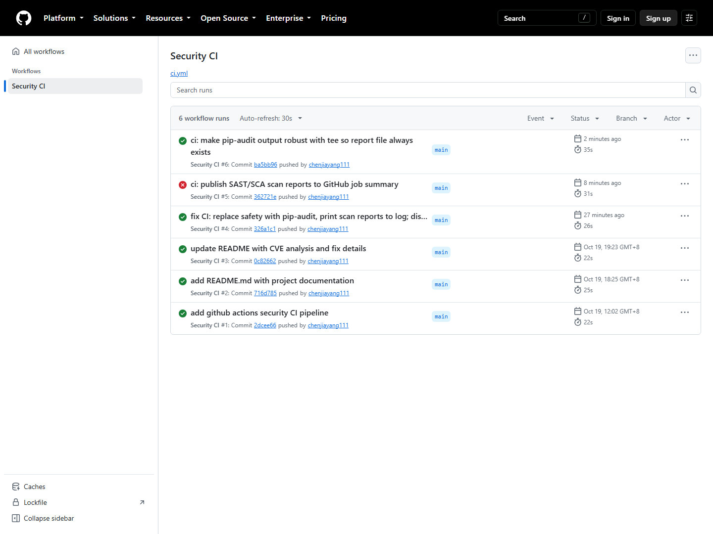
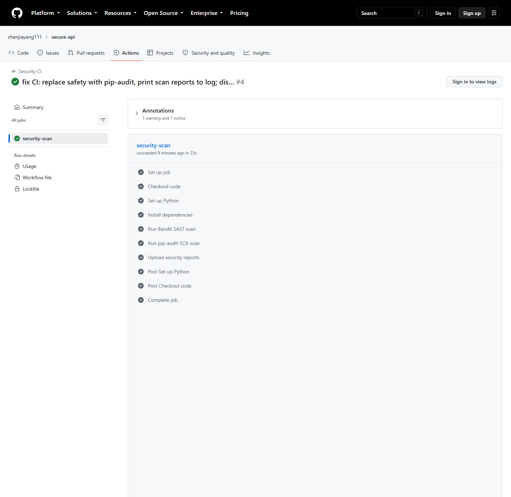
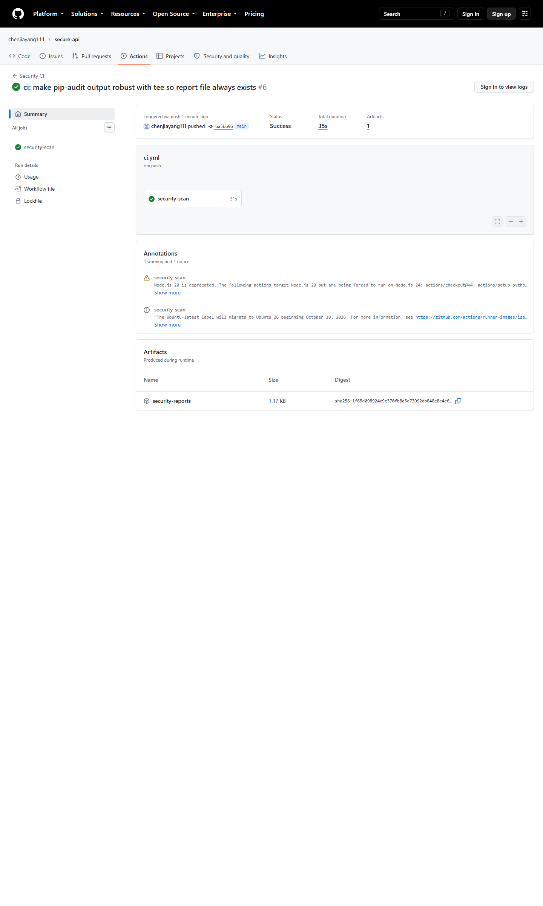
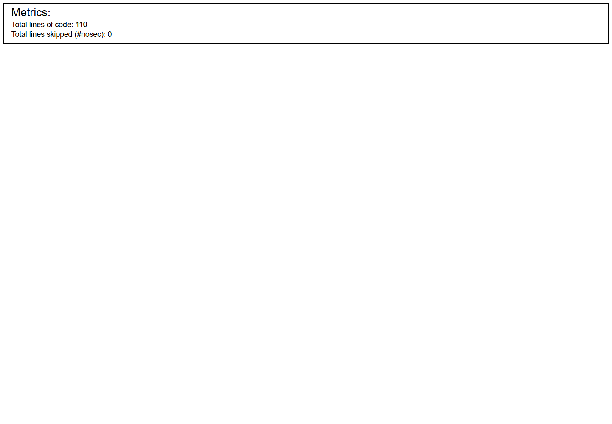

# Secure REST API with CI/CD Security Scanning

## Project Description

This is a secure REST API built with Flask, demonstrating secure coding practices and automated security scanning in a CI/CD pipeline.

### API Endpoints

| Method | Endpoint | Description | Auth Required |
|--------|----------|-------------|---------------|
| POST | `/auth/register` | Register a new user | No |
| POST | `/auth/login` | Login and receive JWT token | No |
| GET | `/api/data` | Get current user's posts | Yes (JWT) |
| POST | `/api/posts` | Create a new post | Yes (JWT) |

---

## Security Measures Implemented

### 1. Protection against SQL Injection

**Implementation**: Using Flask-SQLAlchemy ORM with parameterized queries. All database queries use ORM methods (e.g., `User.query.filter_by(username=username)`) which automatically escape user input. No string concatenation is used to build SQL queries.

```python
# Example: parameterized query via ORM
user = User.query.filter_by(username=username).first()
```

### 2. Protection against XSS (Cross-Site Scripting)

**Implementation**: All user-generated content returned in API responses is HTML-escaped using a custom `escape_html()` function that converts special characters (`&`, `<`, `>`, `"`, `'`) to their HTML entity equivalents.

```python
def escape_html(text):
    return (text.replace('&', '&amp;')
                .replace('<', '&lt;')
                .replace('>', '&gt;')
                .replace('"', '&quot;')
                .replace("'", '&#39;'))
```

### 3. Protection against Broken Authentication

**Implementation**:
- **Password hashing**: Passwords are hashed using bcrypt with a salt (never stored in plaintext)
- **JWT tokens**: Upon successful login, a JWT token is issued with a 1-hour expiration
- **Token verification middleware**: All protected endpoints verify the JWT token before processing requests

```python
# Password hashing
bcrypt.hashpw(password.encode('utf-8'), bcrypt.gensalt())

# JWT generation
jwt.encode(payload, SECRET_KEY, algorithm='HS256')

# JWT verification middleware
def token_required(f):
    @wraps(f)
    def decorated(*args, **kwargs):
        token = request.headers.get('Authorization', '').replace('Bearer ', '')
        data = decode_token(token)  # jwt.decode(token, SECRET_KEY, algorithms=['HS256'])
        ...
```

---

## CI/CD Security Pipeline

GitHub Actions runs on every push and pull request:

- **SAST (Static Application Security Testing)**: Bandit — scans Python source code for security issues
- **SCA (Software Composition Analysis)**: pip-audit — scans dependencies for known vulnerabilities

### CI Runs (GitHub Actions)

All checks run automatically on every push and pull request. Latest successful run: https://github.com/chenjiayang111/secure-api/actions/runs/40188327091



*Security CI pipeline — all runs passing (Bandit SAST + pip-audit SCA)*



*Job steps — "Run Bandit SAST scan" and "Run pip-audit SCA scan" both passed*



*Run detail — Success, security-reports artifact uploaded*



*Bandit SAST report — no security issues identified*

---

## API Testing (curl)

```bash
# 1. Register a user
curl -X POST http://127.0.0.1:5000/auth/register \
     -H "Content-Type: application/json" \
     -d '{"username":"alice","password":"Pass123!"}'
# -> {"message":"User created","user_id":1}

# 2. Login and receive JWT
curl -X POST http://127.0.0.1:5000/auth/login \
     -H "Content-Type: application/json" \
     -d '{"username":"alice","password":"Pass123!"}'
# -> {"token":"eyJhbGciOi..."}

# 3. Access protected data WITHOUT token -> denied (401)
curl http://127.0.0.1:5000/api/data
# -> {"error":"Token is missing"}

# 4. Access protected data WITH token
curl http://127.0.0.1:5000/api/data -H "Authorization: Bearer <TOKEN>"

# 5. SQL injection attempt -> blocked (401)
curl -X POST http://127.0.0.1:5000/auth/login \
     -H "Content-Type: application/json" \
     -d '{"username":"alice'"'"' OR 1=1 --","password":"anything"}'
# -> {"error":"Invalid username or password"}

# 6. Create a post with an XSS payload -> escaped on output
curl -X POST http://127.0.0.1:5000/api/posts \
     -H "Content-Type: application/json" -H "Authorization: Bearer <TOKEN>" \
     -d '{"title":"<script>alert(1)</script>","content":""}'
curl http://127.0.0.1:5000/api/data -H "Authorization: Bearer <TOKEN>"
# -> title: "&lt;script&gt;alert(1)&lt;/script&gt;"  (escaped)
```

---

## CVE Vulnerability Analysis

### Selected Vulnerability

**CVE-2018-14574**: Django CommonMiddleware Open Redirect Vulnerability

Django versions before 2.0.8 and 1.11.15 contain an open redirect vulnerability in `CommonMiddleware` when the `APPEND_SLASH` setting is enabled. A maliciously crafted URL starting with double slashes can redirect users to arbitrary external websites, enabling phishing attacks.

### Reproduction Steps

1. Start the vulnerable Django environment using Docker Compose
2. Visit the URL: `http://localhost:8000//www.example.com`
3. The browser will automatically redirect to `www.example.com` (external site)

*[Screenshot: Redirected to external example.com site]*

### Root Cause Analysis

The vulnerability exists in Django's `CommonMiddleware` which handles URL normalization and the `APPEND_SLASH` feature. When processing a path like `//www.example.com`, the middleware incorrectly treats the double-slash-prefixed path as a valid redirect target instead of a local path. Browsers interpret `//www.example.com` as a protocol-relative URL, causing the redirect to go to an external domain.

### Fix Applied

**Solution**: Upgrade Django from 2.0.7 to 2.0.8, which patches this vulnerability.

The fix was implemented by creating a custom Dockerfile that installs Django 2.0.8 on top of the vulnerable base image:

```dockerfile
FROM vulhub/django:2.0.7
RUN pip install django==2.0.8 --no-cache-dir
```

### Fix Verification

After applying the fix:
- Visiting `http://localhost:8001//www.example.com` no longer redirects to an external site
- The double slashes are now treated as part of the local path (URL-encoded as `%2F`)
- Normal functionality of the application remains intact

*[Screenshot: Fixed environment no longer redirects to external site]*
